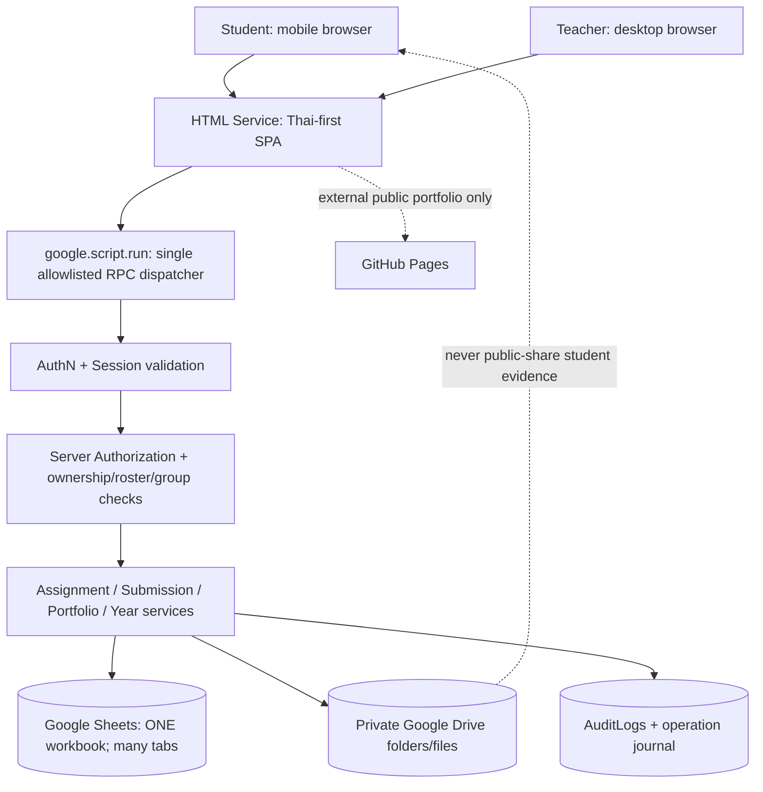

# ARCHITECTURE.md — Deployment and system design

## v2.0 Scoring Service Architecture
เพิ่ม **Teacher-only Grading Service** (Task/Rubric/Bonus/Group attribution) อยู่หลัง AuthN/AuthZ และ Apps Script RPC allowlist โดยอ่านค่าจาก `SyllabusVersions` snapshot และบันทึก `GradeRevisions` immutable. Student Dashboard server response ต้องรวมเฉพาะ own published scores จาก `GradeEntries`, pending=null. ห้าม derive total ผ่าน worksheet count หรือ row score duplicates; join distinct Task ID. Teacher publishes only after schema/task/rubric/roster validation with short locks and operation journaling. Gradebook export เป็น teacher-only. ดู `GRADING_ENGINE.md`, `GRADING_DATA_SCHEMA.md`, `GRADING_API_CONTRACT.md`.

**Status:** proposed / unverified until Phase 1 spike

## 1. Logical architecture

**Important:** The dashed Drive-to-student arrow means **no direct public Drive links**. Student preview is an authorized RPC that obtains a small validated image payload and draws it in the page; a backend `getEvidence` result contains neither a freely accessible Drive URL nor an unchecked file ID. Browser can inspect any returned bytes it is authorized to see, so only deliver its own/group's files.

## 2. Runtime and deployment
- **Frontend:** server-hosted `Index.html`, modular `*.html` partials, bundled CSS and vanilla JavaScript; responsive Thai-first layout. HTML Service uses an iframe sandbox. Keep primary app on Apps Script, not a separate GitHub Pages portal.
- **RPC:** one public `api(request)` dispatcher invoking an explicit allowlist of commands. Internal functions end with `_` and expose no generic Sheet/Drive operations. Any malicious direct call to `api` has server-side actor & resource permission checks.
- **Backend:** Apps Script standalone deployment authorized to access ONLY designated private Sheet and Drive root. Store IDs in Script Properties and secrets outside frontend.
- **Database:** one workbook per environment (dev/staging/prod), multiple normalized tabs and schema migration version; **do not** generate another Sheet per year.
- **Drive:** private root `PhysicsHealthTech/AcademicYear-2570/M4/...`; folder convention is organizational only; rights are enforced in backend.
- **Teacher authentication:** Google identity verification proof-of-concept on Apps Script HTML Service iframe + an allowlist/role table. Do not trust `Session.getActiveUser().getEmail()` in owner-executed anonymous portal. If OIDC doesn't work reliably in iframe, use a separately deployed teacher portal with tested Google Workspace identity mode and isolated authorization, then reassess Drive access; never ship an unverified fallback.
- **Student authentication:** independent secret + code, rate-limited, token session checked on every RPC. See `SECURITY_MODEL.md`.

## 3. Event/data paths
### Login / read
`Browser -> api(login/command) -> verify credential/session -> server actor -> explicit authorization -> Sheets index/read -> sanitized view model -> browser`.

### Upload (two-step, recoverable)
1. `beginUpload` checks session, assignment open/year open, owner/group association, allowed type and budget, returns opaque `upload_op_id` and idempotency key binding; no Drive writes on failure.
2. Browser transforms camera image to JPEG/PNG when supported; previews locally. `uploadEvidence` sends the bounded Blob (HTML form) or bounded encoded data as RPC (proof-tested with iOS); show progress **indeterminate or stage-based** unless true byte-level progress exists.
3. Backend revalidates actor and target, validates size/type/magic bytes, creates file in private **staging** folder and records `UPLOAD_STAGED` journal.
4. Backend verifies Drive file exists and matches expected properties, uses **short script lock** to append immutable `SubmissionVersions` / `SubmissionFiles` and advance `Submissions.latest_version` atomically as far as sheet allows, marks journal `COMMITTED`, then moves/labels Drive file. If sheet commit fails, leave a staged orphan for reconciliation; **never** mark completed with nonexistent file.
5. `completeUpload` is idempotent; replaying same operation returns same committed version, never duplicate files. Client shows success only after persisted verified metadata is read back.
6. Scheduled or teacher-run repair reconciles staged/orphaned files and mismatched rows and raises audit events; never silently discards an upload.

### Private evidence view
`getEvidence({session, evidence_ref})` -> lookup metadata -> verify student owns submission OR is current authorized group member OR teacher -> file is active/linked to visible version -> read bounded bytes via DriveApp -> return authorized MIME/base64 chunk or image data. Avoid Drive public links and ContentService binary proxy: ContentService returns text types, not general-purpose streamed image. For larger files use audited alternate storage/delivery architecture **only after** acknowledging new stack requirement.

### New academic year
Teacher preview -> `createYear(year_be, idempotency_key)` -> validate BE year and uniqueness -> lock -> create `AcademicYears: creating` -> clone grade M4/M5 templates into Assignments as `draft` -> create grade configs -> audit -> mark year `draft`. Retry same key resumes incomplete run; duplicates fail. Teacher reviews/edits, then publishes explicitly.

## 4. Concurrency/data integrity
- `google.script.run` calls are asynchronous; do not infer ordering from UI sequence.
- Use `LockService.getScriptLock()` **around short critical mutations only**. Avoid Drive uploads inside lock; hold lock for check + append/update + flush; finally release.
- Use optimistic `revision` columns to reject stale teacher updates; unique business keys enforced in server code.
- No real SQL transaction; operation journaling, staged files, idempotency, reconcile + tested backups are mandatory.
- Runtime limit and quota changes are real constraints; avoid heavy full-sheet scanning on every tap. Cache non-sensitive indexes and batch `getValues()/setValues()`; never cache one student's private result under a general key.
- Use UTC ISO timestamps in persisted rows, display Asia/Bangkok local times; store year as integer **B.E.** not as Date.

## 5. Capacity/quotas risk
Official Google quota guidance currently gives ~6 min execution runtime and 30 simultaneous executions per user; `google.script.run` permits up to 10 concurrent client calls. These are service limits, **not** guarantees that 80 simultaneous photographic uploads will be reliable. Define load test at 10/20/40 simultaneous students with 1–2 MiB uploads and use measured queueing/failure rates to set policies.

## 6. Drive/Sheet organization
- `DATA_SPREADSHEET_ID` and `PRIVATE_DRIVE_ROOT_ID` in Script Properties (IDs aren't credentials; access must still be restricted).
- Folders per year/grade/`Worksheets`, `IndividualProjects`, `GroupProjects`, `Staging`, `Backups`; filenames opaque UUIDs (not student names/5-digit code).
- Public GitHub Pages URL is student-supplied pointer. No file upload/sharing to GitHub from the private Drive backend.

## 7. Observability and recovery
- Audit metadata mutation and security actions: actor, action, target, outcome, request ID, UTC timestamp. Redact secrets, tokens, prompt contents and private file bytes.
- Health/admin tools: validate cross-tab foreign keys, Drive existence, year template counts, orphan staging, missing version links, duplicate idempotency keys, unauthorized public permissions.
- Backups: versioned Sheet snapshots + private Drive copy/incremental backup under school account; schedule and test restore of representative student+group+year; record last successful backup/restore test.

## 8. Hard stop criteria
Do **not** proceed to production without: tested teacher login in selected deployment mode; student session security; negative IDOR tests; real iPhone upload/preview; quota/load trial; documented backup restore; account and ownership decisions.

## v2 Year Engine + Grades
When creating a new B.E. year, clone **nine draft worksheet assignments per grade** from latest approved template/syllabus mapping into new `SyllabusVersions` **draft** snapshots (never clone last year's actual student grades), ensure 20 sessions ×100-minute metadata, and block course/score publication until approved unique Task weight sum exactly 100 per grade. Previous years' syllabus/grades/history remain accessible under authorization. Cross-year active student evidence remains allowed; separate out-of-roster gradebook policy requires reconciliation.
