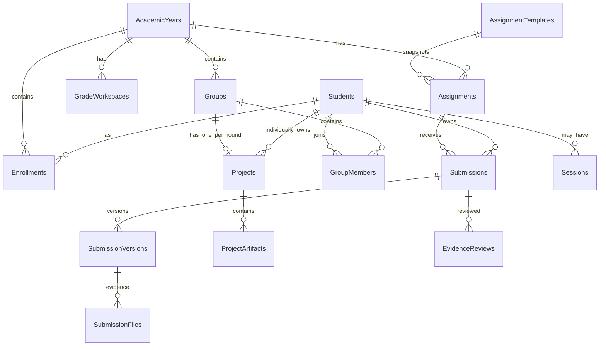

# DATA_SCHEMA.md — One Google Sheets workbook schema

## v2.0 Additive Grading Schema
**MUST IMPLEMENT:** `GRADING_DATA_SCHEMA.md` เพิ่ม `SyllabusVersions`, `TaskDefinitions`, `WorksheetTaskLinks`, `RubricCriteria`, `GradeEntries`, `GradeRevisions`, `BonusAwards`, `GroupScoreComponents`, `IndividualScoreComponents`, `GroupMembershipSnapshots` และตัวเชื่อมหลักฐาน. Sheet เดิมยังอยู่ครบ. `EvidenceReviews` (legacy `evidence_confirmed`) = ตรวจหลักฐาน ไม่ใช่ผลคะแนนวิชาการ. งานคะแนนรอตรวจต้องเป็น null ไม่ใช่ 0. เวอร์ชันใหม่มี **9 worksheet codes ต่อ grade** และ syllabus-approved Task max sum=100. Grade history append only. ใช้รายละเอียดและ Integrity Rules ในไฟล์ส่วนขยายเป็นข้อกำหนดหลัก.

**Schema version:** proposed 1.0 | **Source:** `02_WEBAPP_CONTEXT.md` with extensions for version safety

## 0. Storage conventions
- One workbook per environment, **not one per year**, with below tabs. Row 1 is immutable headers; never use positional column indices in business code (map by header). All unique/foreign-key constraints are validated in backend, because Google Sheets does not enforce relational constraints.
- Stable internal `*_id` = opaque UUID-like string. `student_uid` never changes. `code_5_digit` is a **five-character text** (e.g., `00123`), not numeric.
- Every row supports `created_at`, `updated_at` as applicable, UTC RFC3339 strings; `revision` integer for mutable rows, `deleted_at` nullable for soft deletion. Values are canonical strings/enums, not spreadsheet formulas.
- Public year is B.E. integer `year_be` (e.g. `2570`). `grade` enum `M4 | M5`; `roll_no` integer 1+; `room` text. Persist user text by safely escaping leading spreadsheet formula sigils (`=`, `+`, `-`, `@`) on write, and encode on display to prevent injection.
- Environment-specific configuration stored in Script Properties rather than sheets whenever secret; Sheet ID and root Drive ID restricted by IAM/Drive permissions.

## 1. Core entities (columns, PK, unique key, FK)

| Tab | Primary key | Minimum columns | Constraints & notes |
|---|---|---|---|
| `Students` | `student_uid` | `code_5_digit`, `display_name`, `status`, `credential_version`, `created_at`, `updated_at` | `code_5_digit` unique among active accounts; `status=active\|suspended\|archived`; never store secret in plaintext |
| `StudentCredentials` | `credential_id` | `student_uid`, `verifier_alg`, `salt`, `verifier`, `secret_version`, `issued_at`, `rotated_at`, `revoked_at` | 1 current active credential/student; HMAC verifier for **high-entropy issued secret**, server key in Script Properties (no weak PIN unless stronger KDF/rate-limit design approved) |
| `Teachers` | `teacher_uid` | `google_sub`, `email_for_display`, `role`, `status`, `created_at` | unique Google `sub` for OIDC; only enabled `teacher/admin` may use teacher actions |
| `Sessions` | `session_id` | `principal_type`, `principal_uid`, `token_hash`, `issued_at`, `last_seen_at`, `expires_at`, `revoked_at`, `credential_version` | hashed bearer token only; prune expired; hashed token never returned; scope principal from server |
| `LoginAttempts` | `attempt_id` | `account_key_hash`, `timestamp`, `result`, `cooldown_until`, `reason_code` | bounded audit + durable throttle keyed by account/global attempts; do not persist raw secret or unnecessary IP |
| `AcademicYears` | `academic_year_id` | `year_be`, `state`, `creation_op_id`, `created_at`, `published_at`, `revision` | unique `year_be`; `state=creating\|draft\|open\|archived` |
| `GradeWorkspaces` | `workspace_id` | `academic_year_id`, `grade`, `state`, `created_at` | unique `(academic_year_id, grade)`; exactly M4 + M5 on completed year |
| `Enrollments` | `enrollment_id` | `academic_year_id`, `student_uid`, `grade`, `room`, `roll_no`, `status`, `created_at` | unique active `(academic_year_id,student_uid,grade)` by initial policy; room/roll may be revised with audit; **not an authorization gate to submit** |
| `AssignmentTemplates` | `template_id` | `grade`, `category`, `title`, `order_no`, `required_fields_json`, `template_revision`, `status` | descriptions and types synchronized later from worksheet-document track; not full physics content |
| `Assignments` | `assignment_id` | `academic_year_id`, `grade`, `template_id`, `template_revision`, `title`, `category`, `order_no`, `status`, `open_at`, `due_at`, `revision` | freeze copied template snapshot; unique `(academic_year_id,grade,order_no)` only if order numbers are unique by policy; `draft\|open\|closed\|archived` |
| `Submissions` | `submission_id` | `assignment_id`, `student_uid`, `latest_version_id`, `latest_version_no`, `state`, `out_of_roster`, `roster_review_state`, `deleted_at`, `revision` | **one logical record per** `(assignment_id,student_uid)`; `not_submitted` is derived, not a state row; `out_of_roster` is server-computed |
| `SubmissionVersions` | `submission_version_id` | `submission_id`, `version_no`, `submitted_by_uid`, `submitted_at`, `note`, `state_at_submit`, `out_of_roster_at_submit`, `operation_id`, `deleted_at` | append-only, unique `(submission_id,version_no)` and unique `operation_id` for idempotency |
| `SubmissionFiles` | `evidence_id` | `submission_version_id`, `drive_file_id`, `mime_type`, `size_bytes`, `checksum`, `storage_state`, `uploaded_at`, `deleted_at` | private Drive file metadata; avoid making raw file IDs part of student view-model |
| `Groups` | `group_id` | `academic_year_id`, `grade`, `round_id`, `title`, `status` | one project per group/round; group definition teacher-controlled |
| `GroupMembers` | `group_member_id` | `group_id`, `student_uid`, `membership_role`, `joined_at`, `left_at` | active membership authorizes group artifact access; unique active `(group_id,student_uid)` |
| `Projects` | `project_id` | `academic_year_id`, `grade`, `type`, `owner_student_uid`, `group_id`, `round_id`, `title`, `github_pages_url`, `state`, `revision`, `deleted_at` | `individual`: owner_student_uid required/group_id empty; `group`: group_id required/owner_student_uid empty; unique active `(group_id,round_id)` group projects |
| `ProjectArtifacts` | `artifact_id` | `project_id`, `artifact_kind`, `version_no`, `author_uid`, `text_content`, `submission_file_ref`, `created_at`, `deleted_at` | append-only per project/kind version; artifact kinds `ui_photo\|prompt\|test\|result\|reflection\|link`; file pointer validated |
| `EvidenceReviews` | `review_id` | `submission_id`, `reviewed_version_id`, `teacher_uid`, `review_state`, `feedback`, `reviewed_at` | immutable review history; `submitted\|evidence_confirmed\|needs_revision`; **not by itself** academic content score (v2 uses separate teacher-published GradeEntries) |
| `Operations` | `operation_id` | `actor_uid`, `action`, `target_type`, `target_id`, `idempotency_key_hash`, `state`, `payload_digest`, `created_at`, `last_attempt_at`, `error_code` | states `pending\|staged\|committed\|failed\|reconcile_required`; server controls transition |
| `AuditLogs` | `audit_id` | `actor_type`, `actor_uid`, `action`, `object_type`, `object_id`, `at`, `outcome`, `change_summary`, `request_id` | immutable, no secrets/file bodies; update occurs only by append |
| `AppSettings` | `setting_key` | `value_json`, `updated_at`, `updated_by` | **nonsecret only**; aggregate visibility, size limits, retention schedule; no pepper/key |
| `SchemaMigrations` | `migration_id` | `applied_at`, `checksum`, `actor`, `state` | document/revert migrations safely |

## 2. Entity relationship diagram

**ERD note:** Teacher sessions and group round uniqueness are omitted from diagram for legibility, fully described in table. `Groups -> Projects` one-to-one is scoped by `round_id`, not lifetime.

## 3. Derived teacher submission matrix
1. Filter `Enrollments` for selected `(year, grade, room, active)` sorted numerically `(roll_no ASC, display_name ASC, student_uid ASC)`.
2. For each roster student, left-join `Assignments` and latest non-deleted `Submissions` by `(assignment_id,student_uid)`.
3. Missing join = `not_submitted`. Submission with `state=submitted|evidence_confirmed|needs_revision` shows exact label, but `out_of_roster` is not silently counted as roster completion. If current enrollment matches the selected target, recalculate flag and store a teacher reconciliation event.
4. Out-of-roster inbox = non-deleted Submissions without matching enrollment for their **assignment's year/grade**; grouping by year/grade/assignment, separate count.
5. Aggregate statistics only from roster base (denominator active enrolled students), and separate out-of-roster counts; small-cell suppression for student-facing stats.

## 4. Template snapshot and year creation
`Assignments` copies title/category/order/required fields from `AssignmentTemplates` at a specific `template_revision`. Editing master templates later never silently edits historical assignments. Copy only into `draft`; grade workspaces M4/M5 must both exist before year becomes `draft`.

## 5. Data migration and correctness
- Header-based mapper validates required columns, schema version, uniqueness constraints, FK correctness, and duplicate version numbers on startup/admin health-check.
- Never use `getLastRow()+1` without a script lock for conflicting writes; batch row operations, maintain stable map and reconcile exceptions.
- Script Properties is **not** a high-volume session database; Sessions and LoginAttempts require bounded Sheet storage with cleanup; CacheService is only a performance optimization, never sole security throttle source.
- Reconcile `SubmissionFiles` metadata against Drive files, checksum and size; quarantine missing/invalid; do not present as complete.
- Disable student access to raw workbook. Share backup spreadsheets and private root only with authorized school admins/service owner.

## 6. Suggested test fixtures
Two B.E. years (`2569`, `2570`), M4/M5, 3 rooms, student codes `00007`, `00123`, `91234`, 2 teachers, two groups, one group member removal, 1 out-of-roster submission, 3 immutable versions, 1 soft-deleted evidence file, 1 orphan stage file. All **synthetic data only**.
