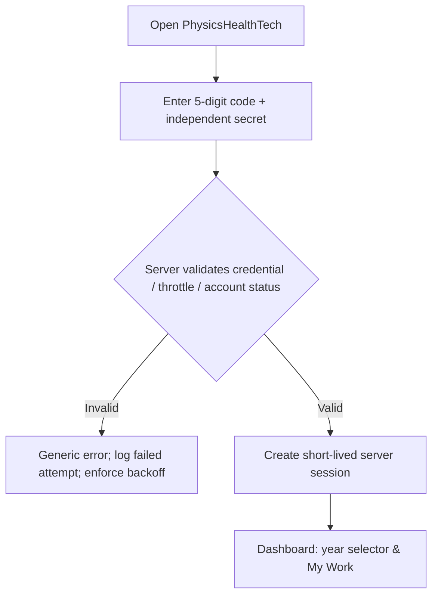
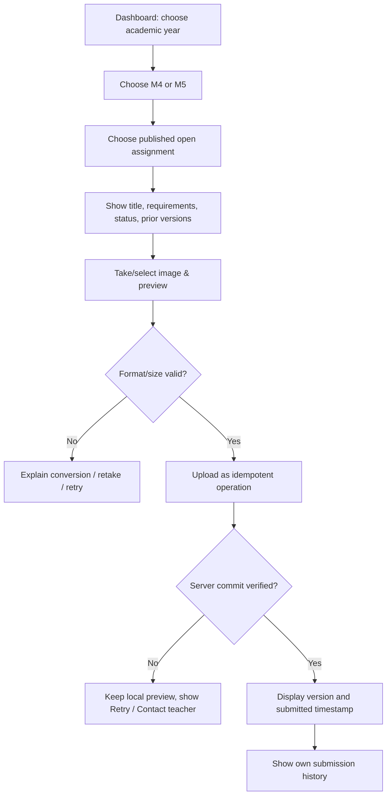

# USER_FLOWS.md — End-to-end user journeys

## v2.0 Additional User Flows
- **Student:** verified login → own roster identity/year → dashboard (earned of reviewed max, provisional accumulation/100, 9 worksheet states) → worksheet card → multiple-page private evidence → `ส่งแล้ว—รอตรวจ` → after teacher grade Publish, `ตรวจแล้ว` + score/feedback. Overdue is an additional badge.
- **Teacher:** verified login → select year/grade/room → numeric roll matrix → evidence → Task rubric draft → Publish reviewed score → student's dashboard refresh. Revision requests update `revision_required` and record old version.
- **Group project:** one project/round → submit shared evidence → verified teacher enters one shared score component and each member's individual score component → freeze membership snapshot → publish and show **each student's own** combined Task score, never peer individual marks.
- **Cross-year:** evidence submission allowed by active account regardless of roster, flagged out-of-roster; teacher must reconcile official enrollment before gradebook publication.

## Flow 1 — Student authentication

Rules: never display whether code exists; server actor = stable `student_uid`; no automatic role from form fields; sign-out invalidates stored session. Teacher-assisted reset revokes sessions; no secret shown in UI afterward.

## Flow 2 — Submit photographed worksheet

**Cross-year/grade:** valid active student may submit an open assignment even when not enrolled in that year/grade. Backend flags `out_of_roster=true`, never rejects based only on roster. Teacher sees it in the out-of-roster tray; it is not a completion of somebody else in roster.

## Flow 3 — Student reviews history
`Login → My Work → choose year → grade → assignment/project → versions → preview/download own authorized image`. Historical year archival hides new submit controls but preserves authorized history. Never list peers' names or files; aggregate statistics obey privacy threshold.

## Flow 4 — Teacher matrix and evidence review
`Verified teacher login → Year → Grade → Room → Assignment → Roster matrix sorted by roll_no numeric (tie-break student_uid) → Student detail → Preview evidence → Review evidence + grade Task/Rubric → Draft/Publish OR Needs revision → GradeRevision Audit`. `not_submitted` is computed by left-joining `Enrollments` to latest authorized Submission **of each roster student**, excluding soft-deleted and out-of-roster submissions belonging to non-roster actors. Teacher can separately open `Out-of-roster Inbox` to reconcile wrong year/grade, link to corrected roster (with audit) or soft-delete.

## Flow 5 — Create a new academic year
`Teacher → Academic Year Manager → enter 2570 → Preview cloned M4/M5 templates → Confirm once → Backend idempotent clone → Draft grade workspaces → Teacher edits assignments → Publish`. Previous `2569` assignments and evidence unaffected. Duplicate click/timeout returns same create operation; verify both grades before publish.

## Flow 6 — Individual project
`Student → My Individual Projects → New Project → title/description → Upload UI paper sketch → Save Prompt v1 → Add test results → Add GitHub Pages URL → subsequent versions → history`. Allow 1+ and additional. URL sanitized and opened external; do not reflect raw HTML.

## Flow 7 — Group project
`Teacher creates roster-backed group/membership/round → One group project per academic year/grade/round → member authenticated → view/edit group artifacts as permitted → record author UID and version for every change → teacher review → archive`. Other groups are 403/denied, including when their ID is guessed. On membership change, server checks current membership and applies immutable attribution to old versions.

## Flow 8 — Corrections/restore
`Teacher → Review details → Needs revision → Student sees label & feedback, uploads new version while assignment open/reopened → Teacher confirms latest`. Incorrect object: `Teacher → Trash/Move → Reason + confirmation → soft-delete/audit → Restore`. Never mutate author UID of original version; move creates recorded reassignment/relink subject to policy.

## Failure UX
- File upload interrupted: retained client preview until page closes, explicit Retry; persisted status obtained from operation query (do not claim background/offline upload).
- HEIC not readable: explain unsupported format, iPhone Settings > Camera > Formats > Most Compatible / export JPEG, do not silently mark success.
- Session expired: show login and restore selected page context without reusing stale token; local-only selected image may need reselection if page reloaded.
- Assignment closed: show history read-only and specific explanation; no submission.
- Out-of-roster: student can submit and sees normal receipt, never sees hidden roster membership of peers.
